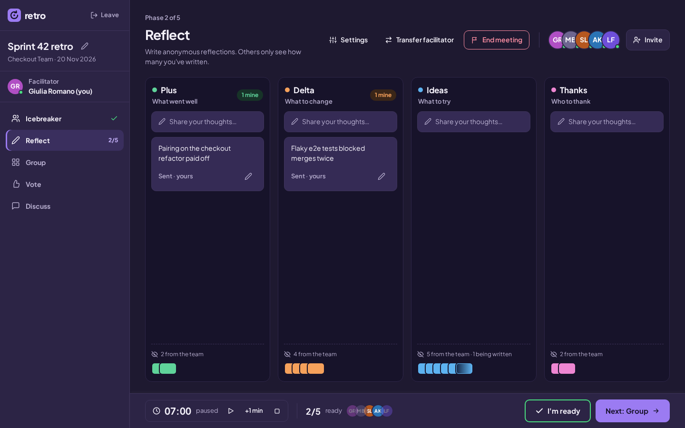
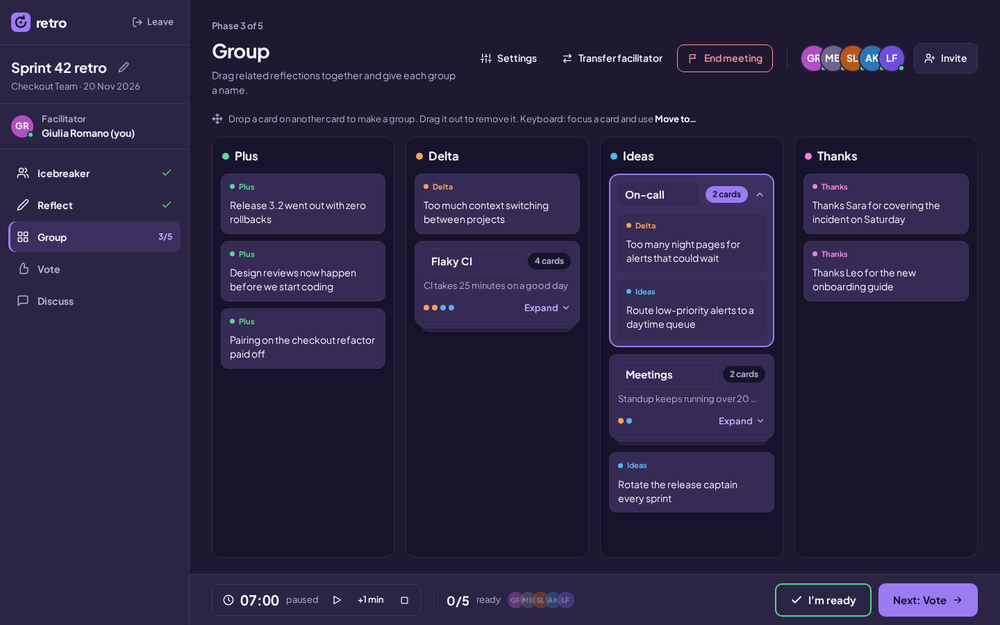
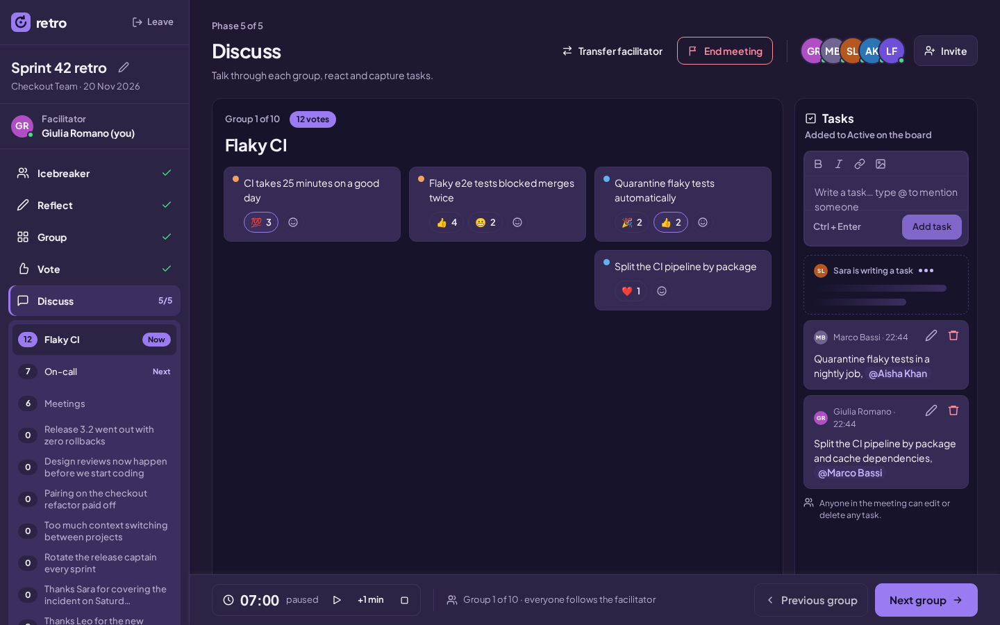
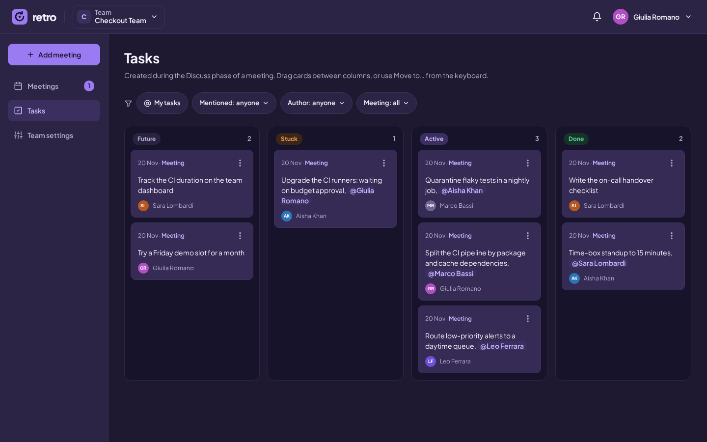

# Retro

  <strong>Team retrospectives, start to finish.</strong>

  Reflect in private, group together, vote on what matters and leave with tasks
  everyone can follow up on.

  

---

A good retrospective needs honest input, a fair way to pick topics and a clear
list of what happens next. Sticky notes and shared docs get you half of that:
the loudest voices go first, the same topics come back every sprint and the
action items are forgotten by Monday.

**Retro runs the whole meeting for you.** A facilitator walks the team through
five phases — Icebreaker, Reflect, Group, Vote and Discuss — while everyone
follows along live. Reflections stay anonymous, votes stay hidden until the
discussion starts, and every task you agree on lands on the team's shared board,
where it stays until it is done.

## Screenshots

  
  

  
  

## Features

### Run the meeting

- **One facilitator** — Leads the meeting, moves through the phases and can hand
  the role over; a team admin can take over at any time.
- **Live for everyone** — Phase changes, cards, groups, reactions and tasks show
  up on every screen as they happen, with who is online.
- **Shared timer** — Presets or a custom duration, pause, +1 minute; the same
  countdown for everyone.
- **Ready check** — Participants mark themselves ready, the facilitator sees the
  count.
- **Invite link** — Share a link that brings people straight into the running
  meeting.

### Five phases

- **Icebreaker** — A "hello" in a random language and a question to answer, one
  person at a time.
- **Reflect** — Write anonymous cards in Plus, Delta, Ideas and Thanks, with rich
  text and images. Nobody sees anyone else's cards, only how many there are.
- **Group** — Drag related cards into named groups together, and see who is
  moving what.
- **Vote** — A vote budget per person and a limit per group; totals stay hidden
  until Discuss, so nobody follows the crowd.
- **Discuss** — Groups in vote order, one at a time, with emoji reactions and
  tasks written right next to the topic.

### Follow through

- **Task board** — Future, Stuck, Active and Done, with drag and drop; tasks from
  every meeting in one place.
- **@mentions and filters** — Mention teammates in tasks, then filter the board
  by who is mentioned, who wrote it or which meeting it came from.
- **Meeting summary** — Every ended meeting keeps a read-only record of its
  participants, groups, votes and tasks.

### Teams and sign-in

- **Teams** — Invite people by email or share a join link; admins manage members
  and roles.
- **Sign-in** — Username and password, single sign-on through any OIDC provider,
  or both.
- **Make it yours** — Light and dark themes and a profile picture.

## Documentation

| Document | Description |
| --- | --- |
| [Specification](docs/specifications.md) | The canonical product specification |
| [Development guide](docs/development.md) | How to run and work on the project |
| [Deployment guide](docs/deployment.md) | Running Retro in production with the Helm chart |
| [Architecture decision records](docs/adr/README.md) | Why things are the way they are |
| [Contribution methodology](AGENTS.md) | The process for making changes, for humans and coding agents |

## License

Released under the [MIT License](LICENSE).
